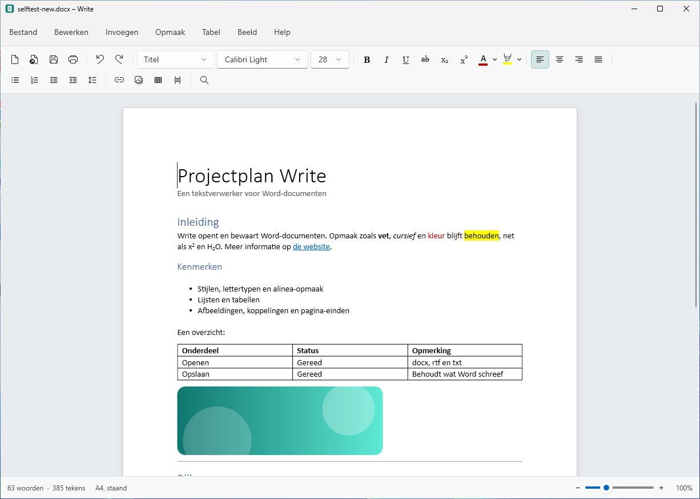
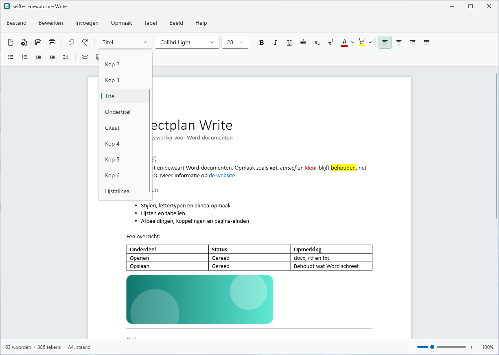
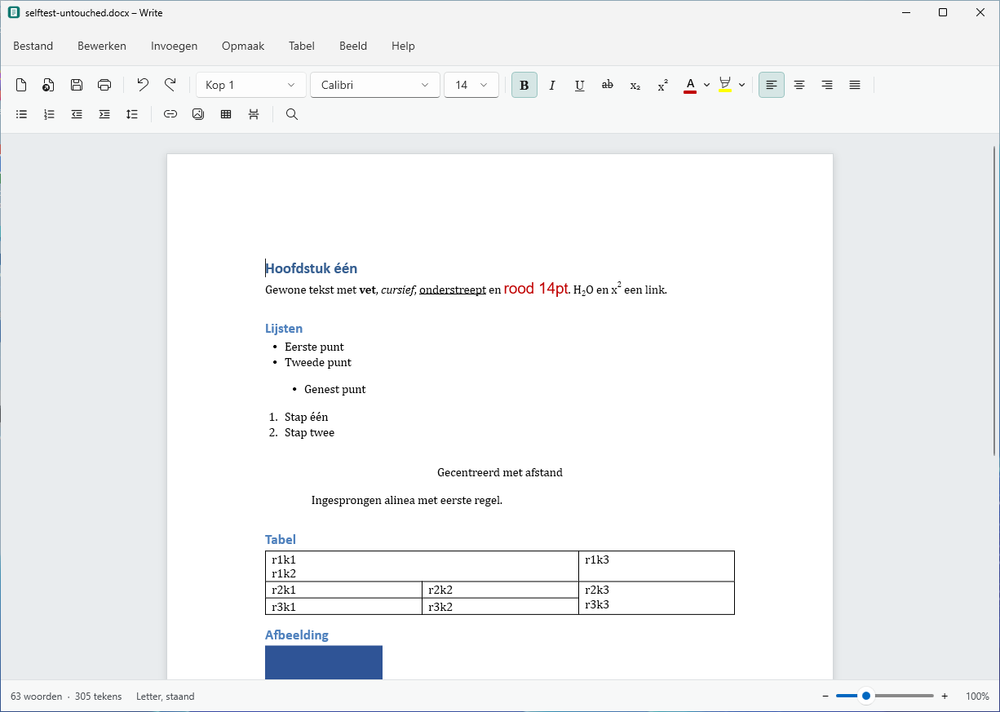
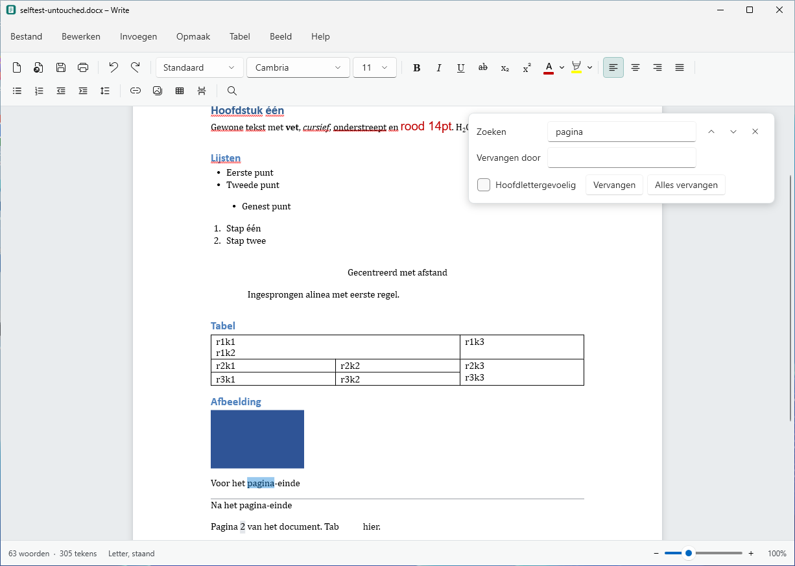

# Write

## Over deze publicatie

Deze broncode is gedeeld bij de AI Report-masterclass over software bouwen met AI.
Je kunt het project bestuderen, zelf draaien, forken en aanpassen onder de [MIT-licentie](LICENSE).
Dit is een voorbeeldproject uit de masterclass; er wordt geen gehoste dienst of doorlopend onderhoud aangeboden.

Een tekstverwerker voor Windows die Word-documenten (`.docx`) opent, bewerkt en opslaat.
Write is een native Windows-toepassing (C# / .NET / WPF): geen browser, geen Electron.



**[Bekijk de video (2 minuten)](docs/write-demo.mp4)**: typen, stijlen, lijsten, opmaak, een tabel,
zoeken en vervangen, opslaan en een bestaand Word-document openen.

## Wat het kan

- **Word-documenten openen en opslaan** (`.docx`), plus `.rtf` en `.txt`.
- **Tekstopmaak**: lettertype, grootte, vet, cursief, onderstrepen, doorhalen, superscript en
  subscript, tekstkleur en markeren.
- **Alinea-opmaak**: stijlen (Standaard, Kop 1–3, Titel, Ondertitel, Citaat en de stijlen uit het
  document zelf), uitlijning, inspringen, regel- en alinea-afstand.
- **Lijsten** met opsommingstekens en nummering, ook genest.
- **Tabellen**: invoegen, rijen en kolommen toevoegen of verwijderen, kolombreedte slepen.
- **Afbeeldingen, koppelingen en pagina-einden** invoegen.
- **Zoeken en vervangen**, **spellingcontrole** (met de talen die in Windows zijn geïnstalleerd),
  ongedaan maken, woordentelling, zoomen.
- **Afdrukken** en **exporteren als PDF** (via *Microsoft Print to PDF*).
- **Pagina-instelling**: papierformaat, afdrukstand en marges.

## Compatibiliteit met Word

Write vervangt bij het opslaan alleen de tekst van het document. De rest van het bestand blijft
zoals Word het heeft gemaakt:

- Kop- en voetteksten, voetnoten en eindnoten, thema's, lettertypetabellen en
  documenteigenschappen blijven ongewijzigd in het bestand.
- Opmaak die Write niet toont (tabstops, randen, taalinstellingen, "bij volgende alinea houden"
  enzovoort) wordt bewaard zolang u de betreffende alinea of tekst niet zelf anders opmaakt.
- Velden (paginanummers, datums), vormen, tekstvakken en formules worden als grijs blokje getoond.
  Ze zijn niet bewerkbaar, maar staan na het opslaan nog precies zo in het document.
- Stijlen blijven stijlen: een alinea met *Kop 1* wordt opgeslagen als *Kop 1*, niet als losse opmaak.

Beperkingen in deze versie:

- De weergave is doorlopend (één lange pagina); pagina-einden worden als lijn getoond. Afdrukken
  en PDF-export gebruiken wel echte pagina's.
- Kop- en voetteksten, voetnoten en opmerkingen zijn niet te bewerken (ze blijven wel behouden).
- Bijgehouden wijzigingen worden bij het openen geaccepteerd.
- Een inhoudsopgave wordt gewone tekst; in Word kan hij opnieuw worden ingevoegd.
- Zwevende afbeeldingen staan in Write in de tekstregel; in het bestand behouden ze hun
  plaatsing zolang hun grootte niet wordt gewijzigd.

## Schermafbeeldingen

De afbeeldingen komen uit de zelftest van de build: het echte venster op Windows.

| | |
| --- | --- |
|  Stijlen |  Een bestaand Word-document |
|  Zoeken en vervangen | |

## Installeren

Elke build op GitHub Actions levert twee bestanden (artifact `Write-<versie>-windows`):

- `Write-Setup-<versie>.exe` – installatieprogramma (startmenu, optioneel bureaubladpictogram,
  Write verschijnt onder *Openen met* voor `.docx`).
- `Write-<versie>-portable.exe` – één bestand, zonder installatie.

Beide bevatten de .NET-runtime; er hoeft niets anders geïnstalleerd te zijn. Windows 10 of 11, 64-bit.

Een tag `v…` pushen maakt een GitHub-release met deze bestanden.

## Zelf bouwen

Nodig: de [.NET 10 SDK](https://dotnet.microsoft.com/download).

```bash
dotnet test tests/Write.Core.Tests
```

```bash
dotnet run --project src/Write.App
```

De toepassing draait alleen op Windows. De DOCX-engine en zijn tests draaien ook op Linux en macOS.

## Opbouw

| Map | Inhoud |
| --- | --- |
| `src/Write.Core` | DOCX-engine zonder afhankelijkheden: leest een pakket in een documentmodel en schrijft het terug. |
| `src/Write.App` | De Windows-toepassing (WPF). `Editing/` zet het model om naar het bewerkbare document en terug. |
| `tests/Write.Core.Tests` | Tests op documenten van Word-compatibele bronnen (python-docx, pandoc, LibreOffice), inclusief schemavalidatie. |
| `tests/fixtures` | Testdocumenten en het script dat ze maakt. |
| `installer` | Inno Setup-script. |

`Write.exe --demo <map> <document.docx>` speelt de rondleiding uit de video af: de toepassing wordt
met echte muis- en toetsenbordinvoer bediend. De workflow *Demo video* neemt dat op Windows op.

`Write.exe --selftest <document.docx> <map>` laat de toepassing zichzelf testen: typen, opmaken,
tabel invoegen, opslaan, een bestaand document openen en ongewijzigd terugschrijven. De build
gebruikt dit om te bewijzen dat de toepassing op Windows werkt en bewaart de screenshots ervan.
